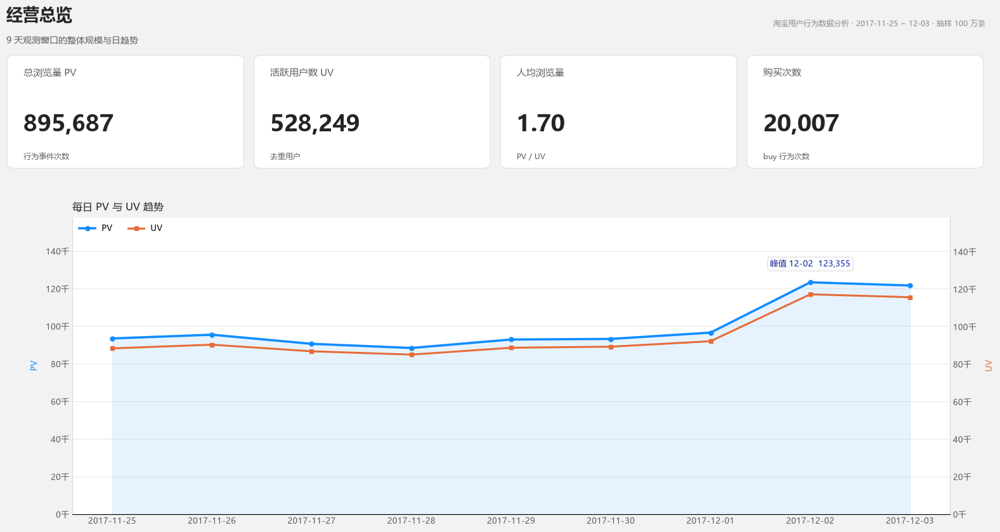
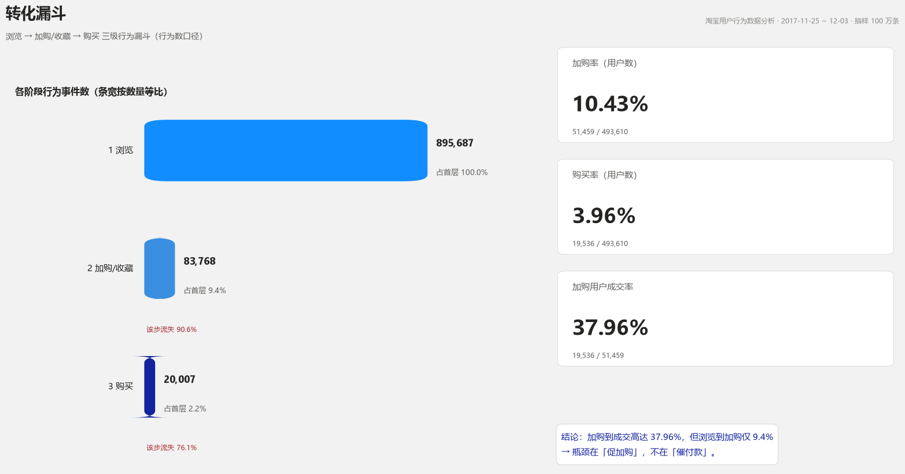
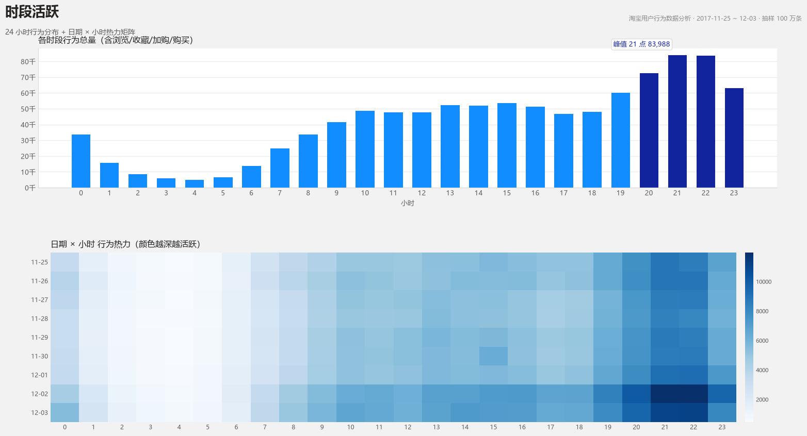
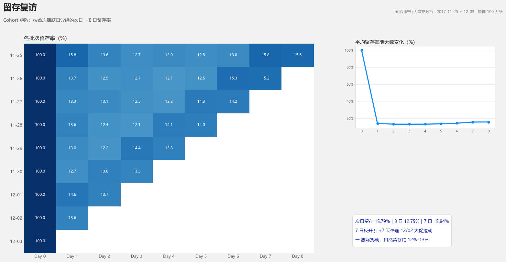
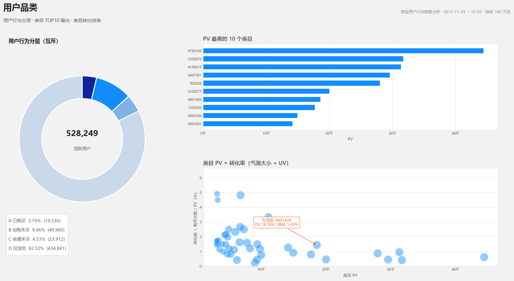

# 淘宝用户行为分析：从 100 万条日志到 5 页经营看板

对阿里天池 UserBehavior 数据集的 100 万条真实行为日志做端到端分析：**MySQL 8.0 清洗与指标计算 → Power BI 五页看板 → 业务结论与建议**。目标不是"做过一个项目"，而是回答四个能直接落到运营动作上的问题。

`MySQL 8.0` · `SQL 窗口函数` · `Power BI (DAX / Power Query)` · `Python (Pandas / Matplotlib)`

---

## 1. 要回答的问题

1. 用户从浏览到购买，究竟卡在哪一步？
2. 哪些时段值得投资源，哪些时段是在浪费预算？
3. 新用户的留存是怎么衰减的，有没有异常？
4. 能不能把用户分层，让运营的每一次触达都有明确对象？

## 2. 数据

| 项 | 说明 |
|---|---|
| 来源 | 阿里天池 UserBehavior 数据集（1% 随机抽样） |
| 规模 | 1,000,000 行，清洗后 999,462 行（剔除时间窗外 538 条，0.05%） |
| 字段 | `user_id`、`item_id`、`category_id`、`behavior_type`（pv / fav / cart / buy）、`timestamp`（秒级） |
| 观测窗口 | 2017-11-25 ~ 2017-12-03，共 9 天 |
| 口径说明 | 无金额字段，所有"价值"判断基于行为频次与用户数，不含 GMV / 客单价 |

## 3. 分析链路

```
CSV → MySQL 8.0（建表 / 清洗 / 指标 / 视图） → Power BI 五页看板 → 分析报告
```

- `sql/01_mysql_pipeline.sql`：五阶段脚本（建表与导入校验 → 清洗 → 核心指标 → 高级分析 → 结论校验）
- `sql/02_bi_views.sql`：为 Power BI 预建的 5 个视图（日粒度、漏斗、时段、留存、RFM 打分）
- `scripts/build_dashboard.py`：从 MySQL 取数并用 Matplotlib 复刻看板配色（Power BI 文件无法版本化，故留一份可执行的出图脚本）
- `report/`：完整分析报告（PDF 9 页 / docx 源文件）

## 4. 核心结论

**① 瓶颈在"促加购"，不在"催付款"**

浏览 895,687 次 → 加购/收藏 83,768 次 → 购买 20,007 次（行为数口径）。**90.6% 的浏览从未产生任何加购**，但加购用户最终成交率达 **37.96%**——说明一旦进了购物车，近四成会成交。该优化的不是支付流程，而是详情页的加购引导（主图、评价、价格锚点）。

**② 82.32% 的用户只看不动作，其中 7.4 万人是最高优先级召回池**

按最高行为层级互斥分层（合计校验等于 UV 528,249）：

| 分层 | 人数 | 占比 |
|---|---|---|
| 已购买 | 19,536 | 3.70% |
| 加购未买 | 49,960 | 9.46% |
| 收藏未买 | 23,912 | 4.53% |
| 仅浏览 | 434,841 | 82.32% |

加购未买 + 收藏未买 = **73,872 人**，这些是有明确意向却没成交的人，优惠券与定向触达应先打这里，而不是无差别拉新。

**③ 20–23 点是黄金时段，21 点见顶**

24 小时分布峰值出现在 21 点（83,988 次），约为凌晨谷底的 18 倍。Push、活动、客服排班应前移至 20–23 点。

**④ 留存：次日 15.79% / 3 日 12.75% / 7 日 15.84%**

7 日留存反而回升，是因为 12-02 大促把老用户拉了回来。剔除大促扰动后，自然留存约 **12%–13%**。前 3 日流失最重，说明平台缺少新客承接机制。

## 5. 看板

**第 1 页 · 经营总览**：PV / UV / 人均 PV / 购买次数四张 KPI 卡 + PV-UV 双轴趋势



**第 2 页 · 转化漏斗**：三层漏斗（按行为数）+ 用户口径转化率



**第 3 页 · 时段活跃**：24 小时柱状 + 「日期 × 小时」热力矩阵



**第 4 页 · 留存复访**：9 个 cohort 的留存矩阵 + 平均留存曲线



**第 5 页 · 用户分层与品类**：四层环形图 + TOP10 类目 + PV × 转化率气泡



## 6. 几个容易被追问的工程细节

- **时区**：`timestamp` 是秒级整数，`FROM_UNIXTIME` 默认按服务器时区解析，会整体偏移时段结论。开头统一 `SET time_zone = '+8:00'` 对齐北京时间。
- **字段类型**：`timestamp` 存在负值与超大值，必须用 `SIGNED` 而非 `UNSIGNED` 建列，否则脏数据在导入阶段就静默溢出。
- **两套口径必须分开讲**：漏斗用**行为数**（一次加购算一次），转化率用**用户数**（一个人只算一次）。混用会得出"加购率 9.4%"和"加购成交率 37.96%"互相矛盾的结论。
- **连续行为识别**：用 gaps-and-islands 锚点法 `DATE_SUB(d_date, INTERVAL rn DAY)` 给连续日期分组；直接用 `d_date - rn` 会在跨月时产生 `20171199` 这种非法日期。
- **为什么没用完整 RFM**：抽样会拆散同一用户的多次购买，实测 19,536 名购买用户中 97.7% 频次为 1，F / M 维度接近随机噪声。因此改用行为分层替代，这在抽样数据上稳健且可解释。

## 7. 局限性

1. **1% 抽样**：全量约 1 亿条，抽样导致 RFM 的 F / M 失真，故不用完整 RFM。
2. **窗口仅 9 天**：7 日留存只有最早几批 cohort 能算全，样本量有限，不可外推为长期留存基准。
3. **大促干扰**：12-02 促销使 7 日留存反常回升，对外汇报须标注"自然留存 12%–13%"。
4. **无金额字段**：无法计算 GMV、客单价，所有"价值"判断都是行为频次口径。

## 8. 目录

```
.
├── sql/
│   ├── 01_mysql_pipeline.sql   五阶段脚本：建表校验 / 清洗 / 指标 / 高级分析 / 结论校验
│   └── 02_bi_views.sql         Power BI 取数视图 ×5
├── figures/                    看板图 ×5
├── report/
│   ├── 淘宝用户行为分析报告.pdf
│   └── 淘宝用户行为分析报告.docx
└── scripts/
    └── build_dashboard.py      从 MySQL 取数复刻看板（Matplotlib）
```

## 9. 复现

```bash
# 1. 导入数据（原始 CSV 见阿里天池，约 100 万行）
mysql -u root -p -e "CREATE DATABASE taobao DEFAULT CHARSET utf8mb4"
mysql -u root -p taobao < sql/01_mysql_pipeline.sql

# 2. 建 BI 视图
mysql -u root -p taobao < sql/02_bi_views.sql

# 3. 出图（需设 MYSQL_PWD 环境变量）
python scripts/build_dashboard.py
```

## 10. 数据来源

数据集来自[阿里天池 UserBehavior](https://tianchi.aliyun.com/dataset/649)，版权归原始提供方所有，本仓库仅用于个人学习与方法演示，不含原始数据文件。
